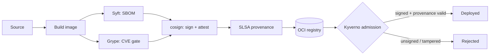

# 🔐 Supply Chain Security Pipeline


-3fb950)


A reference implementation of a **hardened, SLSA-aligned software supply chain**
for container workloads — from source to a signature-verified deployment on
Kubernetes.

> **Status:** 🚧 Building in public. Stages are wired up incrementally — see the
> [roadmap](#roadmap). Nothing here is production-hardened yet.

## Why

Most CI/CD pipelines build and ship containers without provable integrity: no
SBOM, no signature, no provenance, and nothing stopping an unsigned or vulnerable
image from reaching production. This project demonstrates a **secure-by-default**
pipeline that makes tampering detectable and policy-enforced at admission time.

## What it does

- **Build** a container image for a small sample workload.
- **SBOM** — generate a Software Bill of Materials with [Syft](https://github.com/anchore/syft) (SPDX JSON).
- **Scan** — fail the build on high/critical CVEs with [Grype](https://github.com/anchore/grype).
- **Sign** — keyless signing of the image with [Sigstore cosign](https://github.com/sigstore/cosign) (OIDC → Fulcio → Rekor transparency log).
- **Attest** — attach the SBOM as a signed attestation.
- **Provenance** — emit SLSA build provenance (Build Level 3 target) via the official SLSA generator.
- **Verify at admission** — a [Kyverno](https://kyverno.io) `ClusterPolicy` rejects any image on the cluster that isn't cosign-signed and lacks valid SLSA provenance.

## Architecture



## Repository layout

```
.
├── app/                                     # sample workload that gets signed & verified
│   ├── Dockerfile
│   └── main.py
├── policies/kyverno/
│   └── verify-image-signatures.yaml         # admission-time signature + provenance check
├── .github/workflows/
│   └── supply-chain.yml                     # build → SBOM → scan → sign → attest → provenance
├── LICENSE
└── README.md
```

## Quick start (local)

Build and run the sample workload:

```bash
docker build -t supply-chain-demo ./app
docker run --rm -p 8080:8080 supply-chain-demo
curl localhost:8080
```

Generate an SBOM and scan it locally (requires `syft` and `grype`):

```bash
syft supply-chain-demo -o spdx-json > sbom.spdx.json
grype sbom:sbom.spdx.json --fail-on high
```

The full sign → attest → verify flow runs in CI
(`.github/workflows/supply-chain.yml`) and is enforced on-cluster by the Kyverno
policy in `policies/kyverno/`.

## Roadmap

- [x] Repo scaffold + CI skeleton
- [ ] Syft SBOM stage
- [ ] Grype CVE gate
- [ ] cosign keyless signing
- [ ] SBOM attestation
- [ ] SLSA Build L3 provenance
- [ ] Kyverno verification policy + demo cluster manifests
- [ ] End-to-end demo: tampered-image rejection

## License

[MIT](LICENSE) © Moheed Inamdar
