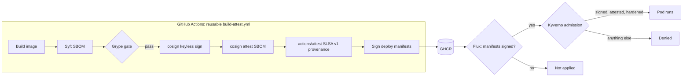

# Supply Chain Security Pipeline

[](https://github.com/moheedinamdar/supply-chain-security-pipeline/actions/workflows/release.yml)
[](https://github.com/moheedinamdar/supply-chain-security-pipeline/actions/workflows/lint.yml)


From commit to pod, nothing runs unless it is verified. A container image is
built, SBOM'd, scanned, keyless-signed and given SLSA v1 build provenance in
GitHub Actions. Its deploy manifests are signed too. On the cluster, Flux only
applies signed manifests and Kyverno only admits signed, attested, hardened pods.

> **Status:** building in public. The `release` badge above is the source of
> truth: every claim below is asserted by the end-to-end job in that workflow.

## Why

Most pipelines ship containers without provable integrity: no SBOM, no
signature, no provenance, and nothing on the cluster that checks any of it.
Signing without verification is theatre. This project closes the loop and
proves it with tests that try to sneak bad images and manifests past the
controls.

## How it works



| Stage | Tool | What it enforces |
| --- | --- | --- |
| SBOM | [Syft](https://github.com/anchore/syft) | SPDX JSON for the exact image digest |
| Vulnerability gate | [Grype](https://github.com/anchore/grype) | Fails on high or critical CVEs that have a fix |
| Signing | [cosign](https://github.com/sigstore/cosign) v3, keyless | Fulcio certificate bound to the build workflow identity, logged in Rekor |
| SBOM attestation | cosign | SBOM signed and attached to the image digest |
| Build provenance | [GitHub artifact attestations](https://docs.github.com/en/actions/concepts/security/artifact-attestations) | SLSA v1 provenance from a reusable workflow ([SLSA Build L3 per GitHub](https://docs.github.com/en/actions/how-tos/secure-your-work/use-artifact-attestations/increase-security-rating)) |
| Deploy-time check | [Flux](https://fluxcd.io) `OCIRepository` | Manifests must be cosign-signed by the build workflow |
| Admission: images | [Kyverno](https://kyverno.io) `ImageValidatingPolicy` | Every image, including init containers, needs the signature, provenance from `main` of this repo, and the SBOM attestation |
| Admission: pods | Kyverno `ValidatingPolicy` (CEL) | Non-root, unprivileged, no privilege escalation, read-only root filesystem, CPU and memory limits, `team` and `cost-center` labels |

### Why a reusable workflow

Keyless certificates name the workflow file that signed. Because signing
happens in [`build-attest.yml`](.github/workflows/build-attest.yml), the trusted
identity is that file on `main`, not whatever workflow called it. The policies
pin exactly that identity, so an image signed from any other workflow (the e2e
job tests this) is denied even though its Sigstore signature is valid.

### Scope

Both Kyverno policies apply to namespaces labelled
`supply-chain-security/enforce: "true"`. System namespaces are untouched, and
the e2e job proves that an unlabelled namespace still admits an unsigned image.

## What the end-to-end job proves

[`scripts/e2e.sh`](scripts/e2e.sh) runs in the `release` workflow on a kind
cluster with Kyverno and Flux. Every line is an assertion:

| Case | Expected |
| --- | --- |
| Signed, attested image in `prod` | Admitted |
| Unsigned third-party image (nginx) | Denied by `verify-image-signatures` |
| Unsigned rebuild of this repo's image | Denied by `verify-image-signatures` |
| Image validly signed by a different workflow | Denied by `verify-image-signatures` |
| Signed app with an unsigned init container | Denied by `verify-image-signatures` |
| Privileged container | Denied by `pod-hardening` |
| Pod without `team` and `cost-center` labels | Denied by `pod-hardening` |
| Unsigned image in the unenforced `sandbox` namespace | Admitted |
| Signed manifests through Flux | Verified, applied, pod running |
| Tampered, unsigned manifests through Flux | `SourceVerified=False`, nothing applied |

## Verify it yourself

Any image built on `main` can be checked without trusting this README:

```bash
IMAGE=ghcr.io/moheedinamdar/supply-chain-security-pipeline@sha256:<digest>
SIGNER=https://github.com/moheedinamdar/supply-chain-security-pipeline/.github/workflows/build-attest.yml@refs/heads/main

cosign verify --certificate-identity "$SIGNER" \
  --certificate-oidc-issuer https://token.actions.githubusercontent.com "$IMAGE"

gh attestation verify "oci://$IMAGE" \
  --repo moheedinamdar/supply-chain-security-pipeline \
  --signer-workflow moheedinamdar/supply-chain-security-pipeline/.github/workflows/build-attest.yml
```

The digest is printed in the `build` job summary of each release run.

## Repository layout

```
.
├── .github/
│   ├── dependabot.yml                  # keeps the SHA-pinned actions and base image current
│   └── workflows/
│       ├── build-attest.yml            # reusable: build, SBOM, gate, sign, attest, sign manifests
│       ├── release.yml                 # caller: build, independent verify, kind e2e
│       └── lint.yml                    # actionlint, zizmor, hadolint
├── app/                                # sample workload (dependency-free Python)
├── deploy/
│   ├── app/deployment.yaml             # hardened Deployment, image digest filled in by CI
│   ├── cluster/namespaces.yaml         # enforced prod, unenforced sandbox
│   └── flux/                           # OCIRepository with cosign verification + Kustomization
├── policies/kyverno/
│   ├── verify-image-signatures.yaml    # ImageValidatingPolicy
│   └── pod-hardening.yaml              # ValidatingPolicy
└── scripts/e2e.sh                      # admission and GitOps assertions
```

## Design notes

- Every action is pinned to a full commit SHA, workflows default to
  `permissions: {}`, and each job asks only for what it needs. No long-lived
  secrets: registry access uses the job's `GITHUB_TOKEN`, signing uses OIDC.
- The image is pushed before the Grype gate so the SBOM describes the exact
  registry digest. If the gate fails, that digest is never signed and admission
  denies it.
- Kyverno 1.19 is tested on Kubernetes 1.33 to 1.35, so the kind node is
  pinned to 1.35 rather than the newer 1.37.
- The legacy Kyverno `ClusterPolicy` is deprecated, so both policies use the
  CEL-based `policies.kyverno.io/v1` types.

## Run the app locally

```bash
docker build -t supply-chain-demo ./app
docker run --rm -p 8080:8080 supply-chain-demo
curl localhost:8080
```

## Roadmap

- [x] Reusable build workflow: SBOM, Grype gate, cosign signing, SBOM attestation
- [x] SLSA v1 provenance with GitHub artifact attestations
- [x] Kyverno image verification and pod hardening policies
- [x] Flux deploy-time signature verification
- [x] kind end-to-end assertions in CI
- [ ] OpenTelemetry traces of each pipeline stage
- [ ] Signed MCP server behind a gateway, enforced by the same policies

## License

[MIT](LICENSE) © Moheed Inamdar
